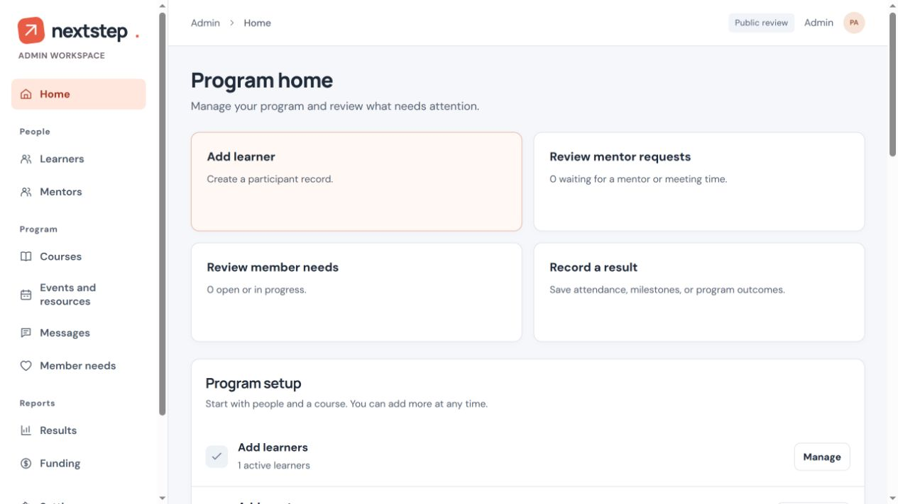

# NextStep

**Keep learning moving when mentor time is scarce.** NextStep is a hackathon prototype for a TechWomenAZ program companion: short AI literacy courses, mentor coordination, participant records, outcome reporting, funding tracking, and community communication in one place.

This is an independent prototype. It is not the official TechWomenAZ website or an endorsed curriculum. The default workspace contains no sample participants, mentors, results, events, or funding records. No donation or program outcome is claimed.

**Public review:** [Open NextStep on Cloudflare Pages](https://nextstep-techwomenaz.pages.dev). This shared test workspace is separate from the local database and is not a production deployment.

**Documentation:** [Complete user guide](docs/USER_GUIDE.md) · [Sample README](README.sample.md) · [Android app guide](mobile/README.md) · [Operations and setup](docs/OPERATIONS.md)



## Run locally

Use Node.js 22 or later compatible with the installed Wrangler version. The project was checked with Node 22.22.1. Run commands from this directory:

```bash
npm ci
npm run db:local
npm run dev
```

Open the local URL printed by Wrangler, normally `http://localhost:8787`. The first API request initializes the administrator, three learning paths, official resource links, and program settings. Sample data is disabled by default. Local D1 persists between restarts under `.wrangler/`.

| Role | Username | Password | Purpose |
| --- | --- | --- | --- |
| Administrator, review | `admin` | `test1234` | Manage the program and view aggregate outcomes |
| Learner, review | `learner` | `learn1234` | Empty Test learner account; or create your own learner account |
| Mentor | Administrator creates login | Administrator chooses initial password | View assigned mentees and coordinate their sessions |

These known credentials work in the local and public review workspaces only. Change the administrator password before using real participant data or a paid AI key. A fresh database seeds only the administrator; choose **Create learner account** to add a learner. The current local and Pages review databases each have the empty Test learner login above. No mentor login or activity is seeded. In **Mentors**, an administrator creates an active profile, then chooses **Create mentor login** and enters a username and password of at least 14 characters. No invitation is sent. Administrator-created learner participant records still do not create sign-ins. `DEMO_MODE=true` blocks external delivery; `SEED_DEMO_DATA=false` keeps sample fixtures off.

```bash
npm run check
npm test
```

Tests use disposable local D1 databases and mocked communication providers. They do not send email or text messages.

For a page-by-page local review guide, run `python3 -m http.server 8788 --bind 127.0.0.1 --directory docs/review` in another terminal, then open `http://127.0.0.1:8788`. Its admin links use `127.0.0.1:8787` and learner links use `localhost:8787` so their login cookies stay separate. Mentor links also use `localhost:8787`: sign out of the learner session first, or use a separate browser profile. All use the same local database. Existing two-role databases need the [mentor migration](docs/OPERATIONS.md#existing-database-mentor-upgrade).

## What works

| Area | Implemented behavior |
| --- | --- |
| Learning | Three original paths, each with three lessons, a baseline quiz, lesson checks, a different follow-up quiz, and confidence ratings. Progress persists in D1. |
| Course guidance | A prepared course guide works without credentials. Optional server-side OpenAI Responses calls provide lesson-grounded help; the UI identifies the mode. |
| Personal journey | Career stage, goal, story, résumé highlights, optional coursework/grades, and optional contact preferences. |
| Application survey | New learners submit goals, interests, experience, availability, and support needs. Staff review status and a response are visible to the applicant; account access and plan assignment remain separate. |
| Member support | Members share needs; staff track open/in-progress/resolved status and a response visible to the member. |
| Membership | Staff can add plans and edit names, descriptions, benefits, prices, six currencies, billing periods, availability, and the default for new learners. Existing assignments survive archiving; no checkout or access gates. |
| Next-step assistant | A planning assistant suggests published courses and program actions. Prepared guidance works without a key; it does not take actions for the user. |
| Mentor access | Transparent keyword and career-stage suggestions, limited scheduling capacity, a meeting cadence, last/next meeting tracking, and external HTTPS meeting links. |
| Mentor workspace | Separate login, own professional profile, assigned mentees, and assigned session updates; no grades, contacts, or program-wide records. |
| Program management | Participant records, editable courses, mentors, resources, events, and program settings. |
| Results | Paired course assessments, cohort/stage filters, workshop records, CSV import/export, and a printable impact snapshot. |
| Funding | Prospects, applications, commitments, receipts, deadlines, and notes. Requested and received amounts remain distinct. |
| Communication | Cohort-targeted in-app updates and read acknowledgments; reviewed email/SMS drafts, a persistent queue, scheduled sending, cancellation, and consent checks. External sending is disabled in demo mode. |

The three roles are administrator, learner, and mentor. Learners use **Home**, **Learn**, **Find a mentor**, **Membership plans**, **Applications**, **Messages**, **Get help**, and **My profile**; mentors use **Home**, **My mentees**, and **My profile**. Meetings open external HTTPS rooms; the app does not host video or create calendar invitations. Mentor verification remains a staff-reviewed field.

Admins manage plans in **Membership plans** using **Add plan** or each plan's edit button. Prices are published information: the app does not charge members or enroll them in a paid subscription. Pick an active default plan for new learner accounts; assigning a different plan remains a staff action. Twelve career stages are available in registration, profiles, mentor records, and filters, including students, returning professionals, technical specialists, senior leaders, and founders.

The [Flutter Android app](mobile/README.md) shares the website's accounts and database. Learners and admins have native workspaces; advanced CSV and message delivery controls open the web app. Use [the Android download page](https://nextstep-techwomenaz.pages.dev/android.html) for the internal ARM64 test build. It is not a Play Store release.

To apply, create a learner account or sign in, open **Applications**, and choose **Start learner application**. Goals and interests are required; other survey answers are optional. Learners can edit submitted applications or respond to follow-up requests. Admins open **People → Applications**, read a submission, and save its status and a response. The applicant sees that response. Reviews do not automatically create accounts or change membership plans.

## How suggestions and measurements work

Mentor suggestions compare words in the learner's goal, story, and résumé with mentor expertise and experiences, then add a small same-stage bonus. This is a visible, simple heuristic, not an AI assessment of someone's suitability. Grades do not affect matching, access, assessment scores, or permissions. Staff still coordinate the actual connection.

Course score change uses the same enrollment's before-and-after quiz scores, expressed in **percentage points**. Moving from 40% to 70% is +30 percentage points. Incomplete pairs are excluded from that average; sample size is shown. Confidence is a separate self-reported 1–5 measure. Workshop results are reported separately from self-paced courses. These are descriptive practice measures, not proof that the program caused a career outcome.

See [metric definitions and operational details](docs/OPERATIONS.md#metric-definitions).

## Optional services and deployment

The core preview needs no AI, email, or SMS account. Administrators can change the model and save a write-only API key in **Settings**. The default model is `gpt-6.2-sol`; calls use the server-side Responses API. A saved key is encrypted with AES-256-GCM under `AI_SETTINGS_KEY` and overrides `OPENAI_API_KEY`. Blank keeps the saved key; removing it restores any environment-key fallback. API responses never return the key. See [AI settings](docs/OPERATIONS.md#administrator-ai-settings). No live AI key or model access has been verified; prepared guidance works without one.

Email uses Resend; SMS uses Twilio. Secrets stay in Worker bindings, never browser code. Demo mode blocks actual delivery even if provider credentials are configured. In production, a queue status of `sent` means the provider accepted the request, not that a recipient received or read it.

Production is a separate Wrangler environment with `DEMO_MODE=false` and its own D1 database. It starts with curriculum and one administrator, without the fictional participant/mentor/outcome records. It requires a strong `ADMIN_PASSWORD` for first initialization. Never point production at a demo database; a stored mode check rejects that configuration.

**Deployment status:** the [Pages review site](https://nextstep-techwomenaz.pages.dev) is live. Publish checks verified both review logins, three courses, five official resources, and no mentor profiles or preloaded activity/results. It uses a dedicated D1 database with `DEMO_MODE=true` and `SEED_DEMO_DATA=false`; external email/SMS is blocked, no live AI key is configured, and the Pages package has no cron. See [Pages deployment details](docs/PAGES_DEPLOY.md). The separate production Worker is **not deployed** and still needs its own database binding and production setup in the [operations runbook](docs/OPERATIONS.md#cloudflare-deployment).

## Project layout

```text
src/index.ts                 Worker API, authentication, validation, D1 workflows
src/content.ts               Original course content and optional test fixtures
src/communications.ts        Resend and Twilio adapters
src/assistant.ts             Bounded next-step planning and prepared fallback
src/ai-settings.ts           Encrypted administrator AI configuration
public/                      Responsive browser interface and static headers
migrations/schema.sql        D1 schema, constraints, and audit triggers
migrations/0002_mentor_accounts.sql  Upgrade existing two-role databases
migrations/0003_applications.sql     Add surveys to existing databases
mobile/                      Native Flutter Android learner and admin app
tests/                       Backend integration and mocked provider tests
wrangler.jsonc               Local preview and separate production Worker configuration
wrangler.pages.jsonc         Public Pages review and its dedicated D1 binding
scripts/build-pages.mjs      Builds static assets and a fetch-only Pages API bundle
docs/OPERATIONS.md           Setup, services, data handling, and launch limits
docs/PAGES_DEPLOY.md         Public Pages review setup and limitations
docs/DEMO.md                 Three-minute demonstration and judging narrative
```

## Why these features

The public [TechWomenAZ website](https://techwomenaz.org/) describes mentorship, community, career growth, and programming across career stages. Its [events section](https://techwomenaz.org/#events) directs visitors to social channels for upcoming announcements, and its [membership link](https://forms.gle/qVG6HHXMBRN1axN96) uses a Google Form. Those observations suggest an opportunity for continuity between events; they do not establish that any internal system is broken.

The project requester separately reported scarce mentor time, limited funding, inadequate software, and results stored in Google Docs. These reported needs shaped the self-paced curriculum, centralized records, and funding workflow. They were not independently verified from the public website.

## Readiness boundaries

This is a working, tested prototype with targeted integration review, not a completed production security audit. It has server-enforced roles, hashed passwords, HTTP-only sessions, bounded requests, and database guards for key concurrent operations. Before onboarding real participants, complete provider verification and delivery testing, choose recovery/MFA and account-verification flows, establish data retention and backup operations, and review program content and mentor credentials. See the [specific launch limitations](docs/OPERATIONS.md#known-limitations) rather than treating the demo as a production certification.

For the presentation, use [the three-minute demo guide](docs/DEMO.md).
